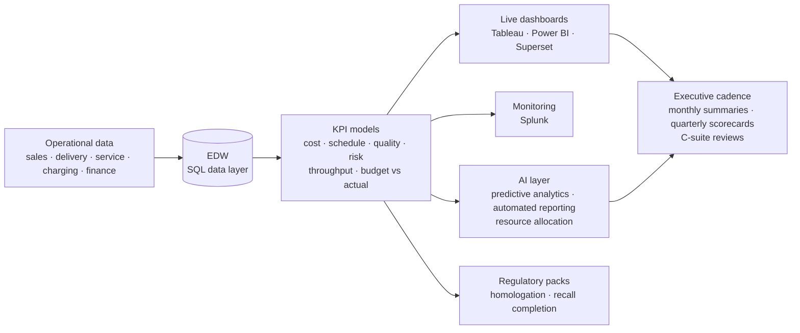

# Mohammad Alahmad

**Strategy & Operations leader.** 10 years across the GCC and EMEA, spanning market research, engineering delivery and regional operations leadership. At Tesla I lead strategy and operations for GCC and south EMEA markets: market entry, network scale-up, P&L and cost control, and the data and AI layer behind executive decisions.

📍 Dubai, UAE<br>
🌐 Arabic (native) / English (fluent)<br>
🎓 B.Sc. Civil (Structural) Engineering<br>
📜 PMP

[](https://linkedin.com/in/pemalahmad)


---

## At a glance

| | |
|---|---|
| **10 → 950+** | customer-facing locations as the network scaled |
| **~30%** | service productivity uplift through analytics-led turnarounds |
| **~20%** | lower operating spend, saving up to **$40M** a year |
| **~$300M** | quarterly revenue in the regional P&L remit |
| **2 market launches** | Saudi Arabia and Qatar, from business case to delivery |
| **Up to 3,500** | people in the peak organisation, led through country and functional managers |

---

## Featured project

### [FleetOps KPI: fleet operations as one system of equations →](https://github.com/Pemalahmad/FleetOps-KPI-Dashboard) · [live dashboard ▶](https://pemalahmad.github.io/FleetOps-KPI-Dashboard/)
Every fleet KPI connected in one network, built on my **Three Clocks Doctrine**: exact identities (off-road hours = visits × hours per visit = workshop + pick-up + back to operations) and measured drivers (multiple regression with standard errors, p-values and confidence intervals), a what-if simulator, and job-level evidence (logistic regression, risk ratios, Welch tests). Repeat repairs, time to pick up, back to operations, parts ETA, fines, goodwill and service spend sit beside CSAT, key-to-key, backlog, productivity, depreciation and compliance. A tested dbt-style SQL pipeline (56 models, 34 validation rules, 22 data tests) runs **in the browser** on DuckDB-WASM, on the demo fleet or on anyone's own files; built in TypeScript / Next.js, with a Python CLI.

[](https://pemalahmad.github.io/FleetOps-KPI-Dashboard/network/)

---

## Data, SQL & AI: the decision layer

At Tesla I built the operations-analytics capability from the ground up: an **enterprise data warehouse (EDW) on SQL**, the KPI models on top of it, and the live dashboards that gave the C-suite **one source of truth** across 10 markets. It replaced manual consolidation with automated reporting.



| What I built | What it changed |
|---|---|
| **EDW / SQL data layer** across sales, delivery, service and charging | One source of truth for leadership; no more manual consolidation |
| **KPI dashboards** (Tableau, Power BI, Apache Superset) tracking cost, schedule, quality and risk | Underperforming markets and service centers surfaced early, driving the ~30% productivity turnarounds |
| **Monthly management summaries and quarterly scorecards** from the same layer | Executive reviews run on validated, consolidated data |
| **Regulatory reporting packs** from the EDW | Evidence behind approval, homologation and recall-completion submissions to government authorities |
| **AI-driven KPI development, predictive analytics, automated reporting and resource allocation** | Risks surfaced earlier and decisions made faster; each market opening became a repeatable playbook |
| **AI agents** for deep competitive and account research on new B2B leads | Every pitch built on the prospect's own market position |

<details>
<summary><b>How I write KPI SQL</b>: an illustrative pattern (synthetic schema, not employer code or data)</summary>

```sql
-- Service-center turnaround & throughput: flag centers drifting from the regional baseline
WITH jobs AS (
    SELECT
        center_id,
        DATE_TRUNC('week', closed_at)                          AS wk,
        COUNT(*)                                               AS jobs_closed,
        AVG(EXTRACT(EPOCH FROM closed_at - opened_at) / 3600)  AS avg_turnaround_h
    FROM service_jobs
    WHERE closed_at >= DATE_TRUNC('week', CURRENT_DATE) - INTERVAL '12 weeks'
      AND closed_at <  DATE_TRUNC('week', CURRENT_DATE)   -- complete weeks only
    GROUP BY 1, 2
),
scored AS (
    SELECT
        j.*,
        ROUND(jobs_closed::numeric / NULLIF(c.technician_count, 0), 2) AS jobs_per_tech,
        AVG(avg_turnaround_h) OVER (PARTITION BY wk)           AS region_turnaround_h,
        AVG(jobs_closed) OVER (PARTITION BY center_id
             ORDER BY wk ROWS BETWEEN 3 PRECEDING AND 1 PRECEDING) AS trailing_4wk_jobs
    FROM jobs j
    JOIN service_centers c USING (center_id)
)
SELECT
    center_id, wk, jobs_closed, jobs_per_tech,
    ROUND(avg_turnaround_h, 1)                                 AS turnaround_h,
    ROUND(100.0 * (avg_turnaround_h / region_turnaround_h - 1), 1) AS pct_vs_region,
    CASE WHEN avg_turnaround_h > 1.2 * region_turnaround_h
           OR jobs_closed   < 0.8 * trailing_4wk_jobs
         THEN 'INTERVENE' ELSE 'OK' END                        AS status
FROM scored
ORDER BY wk DESC, pct_vs_region DESC;
```

The same pattern (baseline, drift and an explicit intervention threshold) sits behind turnaround work: the dashboard doesn't just report, it tells a manager where to act this week.
</details>

---

## Case studies

### 1 · Network, service & leadership: Tesla
**Scaled the network to 950+ locations and lifted service productivity ~30%.**
- **Built repeatable operations.** Operating models, site playbooks and training frameworks, with staffing, parts, service workflows and escalation aligned to each market.
- **Made performance actionable.** Built the enterprise data warehouse (SQL/EDW) and live KPI dashboards (Tableau, Power BI, Apache Superset) used to guide turnarounds of underperforming markets and service centers.
- **Developed leaders.** Hired, trained and led country and functional managers, connecting workforce plans, targets and resource allocation to regional priorities.
- **Turkey footprint:** 90,000-vehicle fleet · 6 stores · 9 service centers · 24 Supercharging stations.

### 2 · Market entry: Tesla Saudi Arabia & Qatar
**Launched operations in two markets, delivering 5,000 and 4,000 vehicles in their opening quarters.**

`Business case` → `Readiness` → `Mobilization` → `Delivery`

Market assessment and budgets; funding, hiring, policy and infrastructure coordination; site selection, workforce plans and launch playbooks; then sales, service, charging and vehicle-delivery operations. Related regulatory work covered vehicle homologation, product approvals with engineering, policy and government teams, and consumer-finance programmes structured with central banks in four countries.

### 3 · Cost & operating control: Tesla regional P&L
**Reduced operating spend ~20%, saving up to $40M a year.**
Owned regional, unit and departmental P&Ls: cost control, margin protection, cash flow, forecasting and budget-versus-actual. Led annual planning, target setting and resource allocation. Built the expansion business cases and ROI analysis, validated them with external consultancies and took them through C-suite decision to implementation. Supported M&A with financial analysis, due-diligence input and post-deal integration.

### 4 · Programs & production: Creators HQ / 1 Billion Followers Summit
**Coordinated 50+ influencers across multi-set productions** (project-based, 2023 to present). Built program frameworks, production SOPs, equipment-allocation plans and ClickUp task structures to run creator shoots, summit production and live events end to end.

### 5 · Engineering delivery: Stantec
**Led structural workstreams from concept to authority approval** as Engineer of Record on Abu Dhabi and UAE developments: an Abu Dhabi canal project, Saadiyat Island developments, and the Arada Central Business District at Aljada (40 office blocks, ~4.3M sq ft). Managed scope, budgets and milestones in Primavera, and worked authority approvals with TAQA and Abu Dhabi Municipality.

### 6 · Design to fabrication: Gulf Precast
Built fabrication-ready TEKLA packages for a residential tower on Al Reem Island, and optimised reinforcement and mix designs to cut material use and production lead time.

### 7 · Market research: Telecommunications Regulatory Authority (now TDRA)
**Led the market research behind the UAE entry of Virgin Mobile and Swyp,** from methodology and survey design to strategic entry recommendations. Benchmarked du and Etisalat against operator KPIs and turned survey and social-response analysis into a 40% CSAT improvement.

---

## Career roadmap

> From analysis to delivery. From delivery to regional leadership.

| Years | Organisation | Capability added |
|---|---|---|
| 2016 – 2018 | TRA (now TDRA) | Market & regulatory analysis |
| 2018 – 2019 | Gulf Precast | Design-to-production coordination |
| 2019 – 2021 | Stantec | Project controls & multidisciplinary delivery |
| 2021 – present | Tesla | Regional strategy, operations & P&L leadership |
| 2023 – present | Creators HQ / 1BFS (project-based) | Programs, partners & production operations |

---

## Toolbox

- **Strategy & finance:** business cases · financial modelling · ROI analysis · market entry · scorecards & OKRs · M&A support
- **Data & analytics:** SQL / EDW · data modelling for KPIs · Tableau · Power BI · Apache Superset · Splunk · forecasting · statistical analysis & survey design
- **AI & automation:** Claude Code · Claude · ChatGPT · Microsoft 365 Copilot · Gemini · Power Automate
- **Delivery:** PMO governance · Primavera P6 · MS Project · JIRA & Confluence · ClickUp · SAP · Salesforce

---

📫 **Contact:** [linkedin.com/in/pemalahmad](https://linkedin.com/in/pemalahmad)
